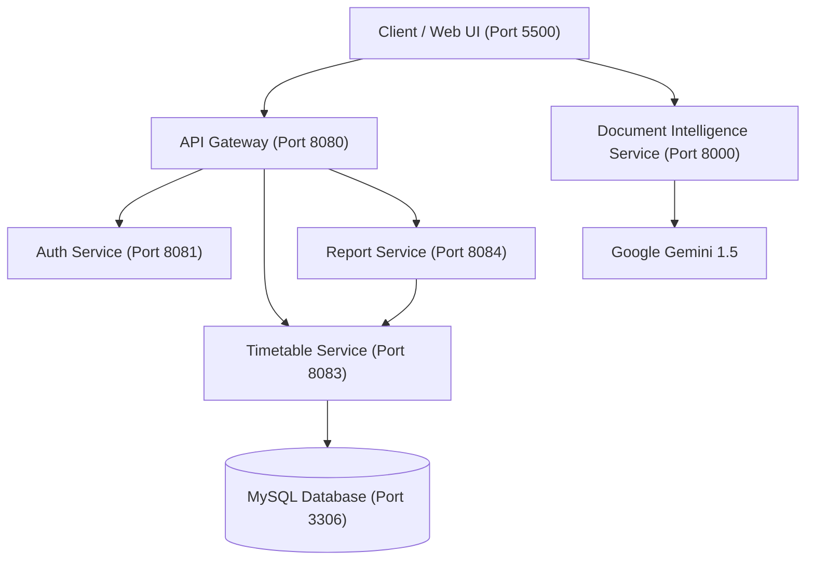

# 📅 IntelliSchedule-AI

> **An AI-powered academic scheduling and automated timetable generation platform.**

IntelliSchedule-AI transforms unstructured academic syllabi, classroom capacities, and faculty preferences into optimal, conflict-free weekly schedules using constraint satisfaction algorithms and generative AI document intelligence.

---

## 🏛️ System Architecture

---

## 🚀 Microservices Overview

| Service | Technology | Port | Purpose |
| :--- | :--- | :--- | :--- |
| **API Gateway** | Spring Cloud Gateway | `8080` | Unified routing, rate-limiting, and CORS management |
| **Auth Service** | Spring Boot, Spring Security, JWT | `8081` | User registration, authentication, and role authorization |
| **Timetable Service**| Spring Boot, Spring Data JPA | `8083` | Academic entities and constraint timetable engine |
| **Report Service** | Spring Boot, OpenPDF, Apache POI | `8084` | Export weekly timetables to styled PDF and Excel files |
| **Document Intelligence**| FastAPI, PyMuPDF, Tesseract | `8000` | Ingest curriculum PDFs with Gemini AI extraction |
| **AI Assistant** | FastAPI, Google GenAI | `8001` | Conversational schedule queries and faculty assistance |
